# E2E run

11 of 11 steps passed · branch `chore/workflow-e2e` @ `55fe4e8` · 2026-10-23T11:43:14.073Z

| # | Step | Result |
|---|---|---|
| 01 | Map opens in the chat view | ✅ the model-visible payload is 388 bytes; the view fetched all 46 apps itself |
| 02 | First-run tour shows how to read the map | ✅  |
| 03 | Legend folds into the help icon after the tour | ✅  |
| 04 | Every segment name is drawn | ✅ 6 of 6 segment names on screen |
| 05 | Apps found opens a sortable table | ✅ sorted by revenue, first row: Notability: AI Notes & Planner |
| 06 | Selecting a row shows the app on the map | ✅ Notability: AI Notes & Planner |
| 07 | Ask Claude sends the question with its context | ✅ q-b0b0a8 reached the chat with its context |
| 08 | Claude's answer shows on the map | ✅  |
| 09 | Export hands the report to the host | ✅ download: file:///e2e-meeting-notes-report.md (11760 chars) |
| 10 | Plan from idea shows an editable plan | ✅ customers, forms and segments as chips |
| 11 | Open in browser shows the same map | ✅  |

**01 · Map opens in the chat view**

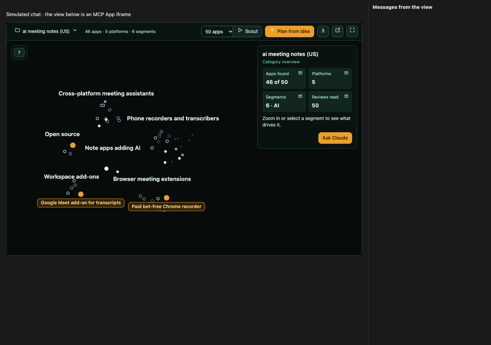

**02 · First-run tour shows how to read the map**

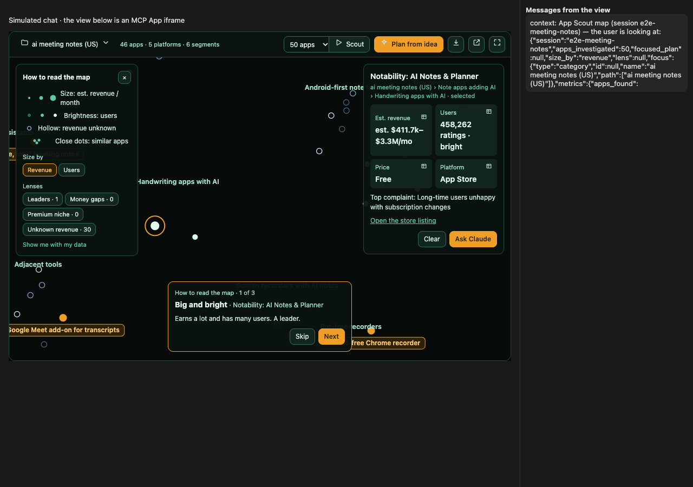

**03 · Legend folds into the help icon after the tour**

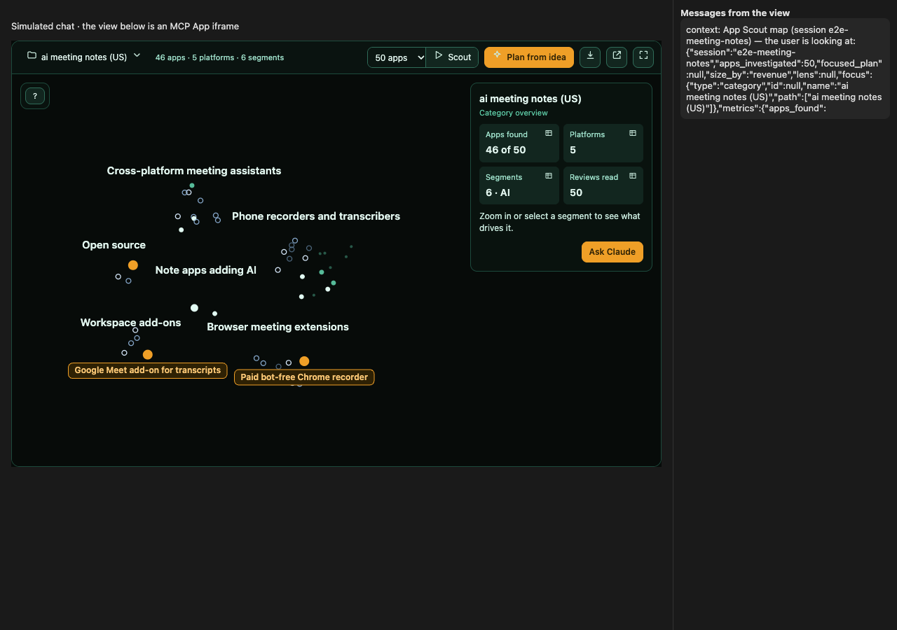

**04 · Every segment name is drawn**

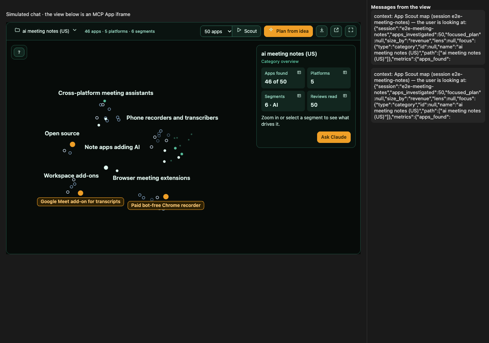

**05 · Apps found opens a sortable table**

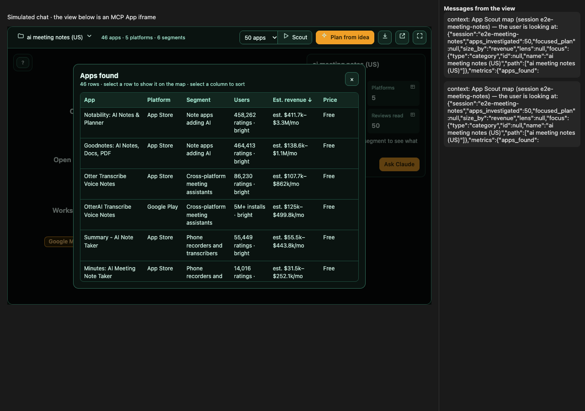

**06 · Selecting a row shows the app on the map**

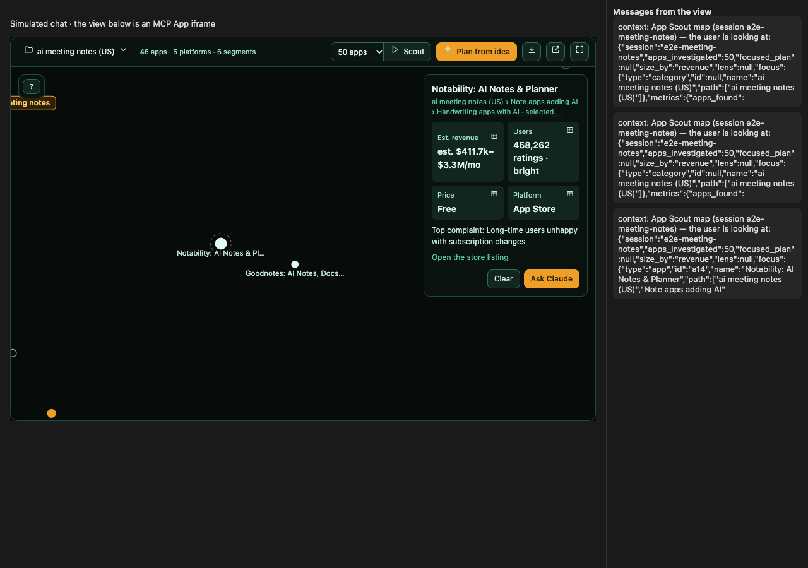

**07 · Ask Claude sends the question with its context**

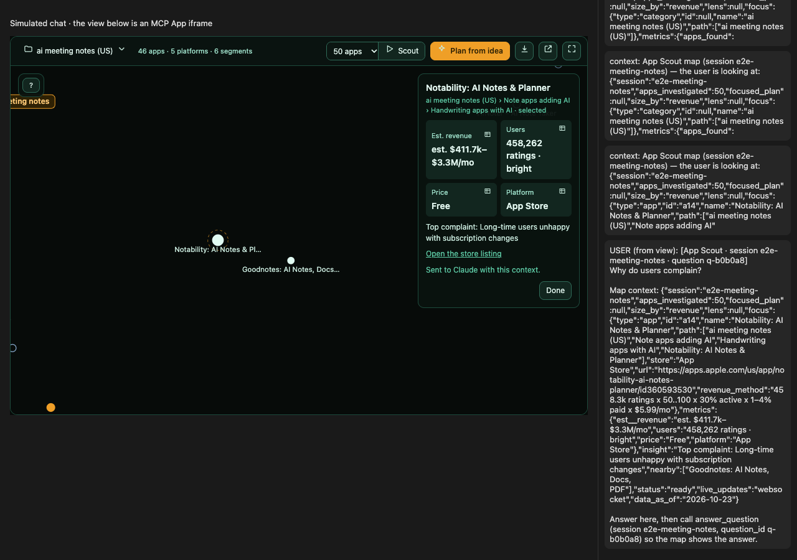

**08 · Claude's answer shows on the map**

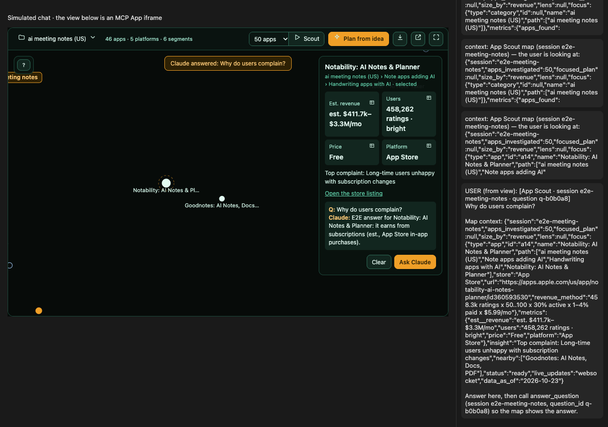

**09 · Export hands the report to the host**

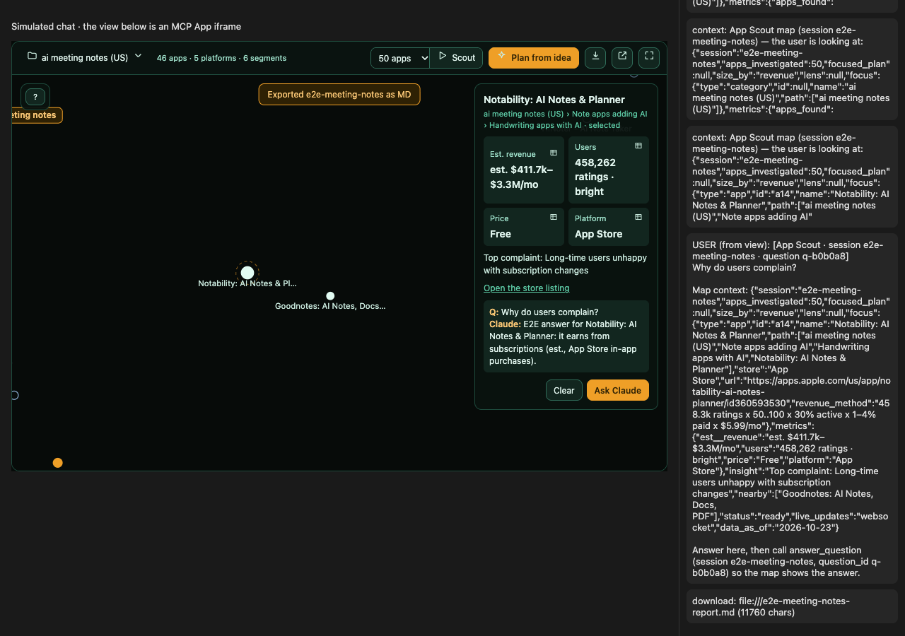

**10 · Plan from idea shows an editable plan**

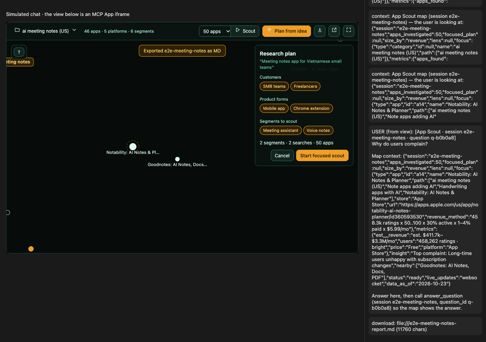

**11 · Open in browser shows the same map**

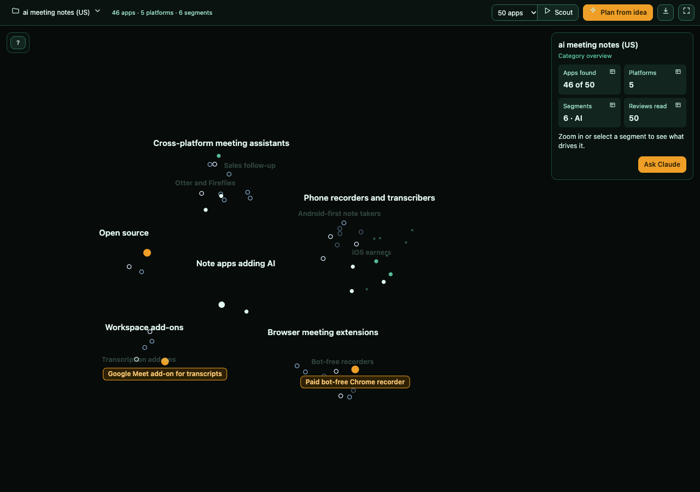
